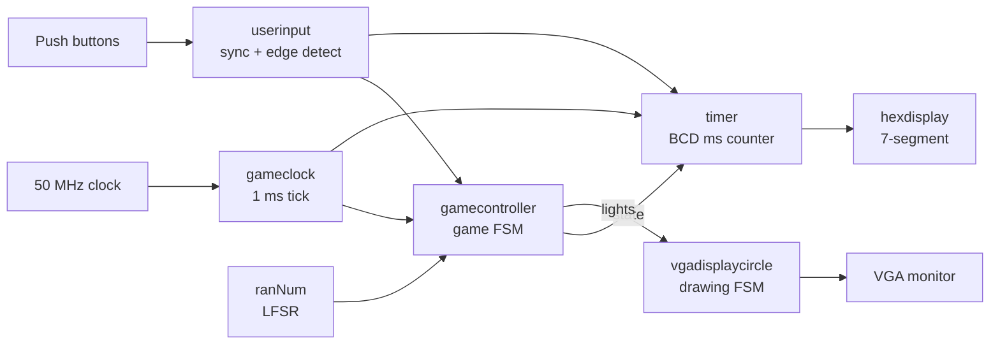

# Lights-Out-and-Away-We-Go
Lights Out and Away We Go: Formula 1 Launch Reflex Game

"It's lights out and away we go!" 
Think you have the reflexes of an F1 driver? Test your launch reaction time on real FPGA hardware. Five red lights illuminate sequentially before holding for a randomized delay. The second they go dark, slam the button to lock in your millisecond score. Jump early and you're flagged for a false start. Did you win over your friend?

## Introduction
A hardware-level Formula 1 race-start reaction game built using digital logic and is implemented entirely in synthesizable Verilog, FPGA, VGA and Audio controller. The system uses a Finite State Machine (FSM), clock dividers, and a Linear Feedback Shift Register (LFSR) to generate a non-deterministic launch window. Record their millisecond response time on a 7-segment display, with multiple rounds.

<!-- Add a photo or GIF of in the future -->

---

## Highlights

- **Pure hardware design.** A finite state machine and datapath on the FPGA, no soft CPU.
- **Pixel-art VGA graphics.** A 320×240, 9-bit-colour F1 start scene, with round "glowing" lights drawn in real time by a dedicated drawing FSM.
- **Millisecond reaction timing.** A decimal (BCD) counter, so the time goes straight to the display with no binary-to-decimal conversion.
- **False-start detection.** Pressing during the light sequence or the random hold ends the round.
- **Randomized launch window.** A linear-feedback shift register (LFSR) varies the hold time so starts can't be anticipated.
- **Verified in simulation.** ModelSim test scripts for the clock divider, the timer and the VGA drawing FSM.

---

## How It Works

Each module has a single job, and modules talk only through clearly defined signals:

| Module | Role | Key idea |
|---|---|---|
| `gameclock` | Divides the 50 MHz clock into a 1 ms tick | One time base for the whole system; enable pulses, not derived clocks |
| `userinput` | Turns raw buttons into clean one-clock "press" pulses | Synchronizer plus edge detection; it knows nothing about the game |
| `gamecontroller` | Runs the game: IDLE → LIGHTS → WAIT → GO → RESULT | One FSM owns the game state; everything else reads it |
| `timer` | Measures reaction time in ms | BCD "odometer" counter that freezes on the press |
| `ranNum` | Generates the random hold time | LFSR seeded by timing entropy |
| `vgadisplaycircle` | Draws the lights on screen | FSM plus counters that redraw only what changed |
| `hexdisplay` | Shows the time on the 7-segment displays | Combinational decoder |

### Game FSM

| State | What happens | Exits to |
|---|---|---|
| `IDLE` | Start screen, all lights off | `LIGHTS` on start |
| `LIGHTS` | One light per second, left to right | `WAIT` after the 5th light, or `RESULT` on a false start |
| `WAIT` | All 5 lights on for a random time | `GO` when the time is up, or `RESULT` on a false start |
| `GO` | Lights out; timer running | `RESULT` on reaction or timeout |
| `RESULT` | Shows the time or the false start | `IDLE` on start |

---

## Engineering Decisions

**Partial redraw instead of full-frame rendering.** The VGA adapter keeps its own picture memory, so the drawing FSM only rewrites pixels when the game changes. When a light turns on, just that light (14×28 pixels) is redrawn. The other four are checked and skipped. A full redraw would rewrite about 77,000 pixels.

**320×240 instead of 640×480.** A 640×480 picture at 9-bit colour takes about two-thirds of the FPGA's on-chip memory. Dropping to 320×240 cuts that to about a sixth, leaving room for more images and audio. It also gives the pixel-art look.

**Circles without image files.** Each light is drawn by comparing the squared distance from the bulb centre (dx² + dy²) with two thresholds: a bright core and a darker glow ring. Comparing squared distances avoids computing a square root in hardware.

**Background and logic stay in sync.** The background scene is loaded into picture memory when the FPGA is programmed. Its light positions were aligned to whole-pixel spacing, and its bulbs drawn with the same circle maths the FPGA uses, so redrawn lights match the background exactly.

**BCD timing.** The reaction time is counted directly in decimal digits. It can be shown on the 7-segment displays or drawn on screen without conversion, and two times can still be compared numerically to decide a winner.

**Fully synchronous design.** All state changes happen on the 50 MHz clock edge. Button inputs pass through a two-flip-flop synchronizer to avoid metastability, and timing uses enable pulses rather than separate clocks. Reaction-time resolution is 1 ms; the synchronization delay is 20 ns.

---

## Verification

Each module is tested on its own in ModelSim before integration:

| Script | What it verifies |
|---|---|
| `gameclock.do` | 1 ms tick at the real 50 MHz rate: a one-clock pulse every 50,000 cycles |
| `timer.do` | Counting, decimal carry (0009 → 0010), freezing on the press, clearing between rounds |
| `vgafsm.do` | Drawing-FSM state sequence, pixel counters, and that only the changed light is redrawn |

---

## Hardware and Tools

- **Board:** Terasic DE1-SoC (Intel Cyclone V FPGA)
- **Language:** Verilog HDL
- **Tools:** Intel Quartus Prime, ModelSim (Intel FPGA Edition), DESim
- **Output:** VGA monitor (640×480 signal, 320×240 framebuffer), 7-segment displays, LEDs

---

## Controls

| Input | Action |
|---|---|
| `KEY[0]` | Reset |
| `KEY[3]` | Start a round / return to the start screen |
| `KEY[1]` | Player 1 reaction button |

---

## Build and Run

1. Create a Quartus project for the Cyclone V `5CSEMA5F31C6` and import the DE1-SoC pin assignments.
2. Add the game modules, the files in `vga/`, and `vga/f1_home_320_9.mif` (keep the MIF next to the `.qpf`, or update the path in `vgadisplaycircle.v`).
3. Set `top` (`vga/vgatop.v`) as the top-level entity, compile, and program the board.
4. To simulate, open ModelSim in the folder containing the module and run `do <script>.do`.
---

## Team

| | Contributions |
|---|---|
| **Jess Chan** | Game controller FSM, reaction timer, clock divider, input handling, VGA drawing FSM and graphics pipeline, background art integration, system integration, ModelSim verification |
| **Aadi Aggarwal** | Random number generator (LFSR), VGA prototyping, PS/2 keyboard receiver, two-player and winner logic, ModelSim verification |

---

## Acknowledgements

This project is a fan-made homage, not affiliated with or endorsed by Formula 1.
